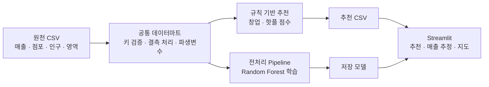

# 서울, 어디서 놀고 어디서 벌까? 🗺️

> 서울 상권 공공데이터를 방문·창업 의사결정 서비스로 연결하는 데이터 분석 및 웹 서비스 프로젝트

**Where U Go**는 방문 목적과 창업 목적에 따라 서울 상권을 다르게 비교합니다. 방문자에게는 젊은층·주말·야간 활동을 반영한 핫플 순위를, 창업자에게는 업종별 추천 상권과 예상 월매출을 제공합니다.

추천 순위는 **규칙 기반 상대점수**, 예상 월매출은 **Random Forest 회귀모델**로 계산합니다.

이 문서는 발표자료 `where_u_go.pptx`를 바탕으로 작성했습니다. 아래 데이터 규모와 검증 결과는 발표자료에 제시된 기준이며, 이번 README 작성 과정에서 데이터 처리나 모델 평가를 다시 실행한 결과가 아닙니다.

## 주요 기능

| 목적 | 제공 기능 |
| --- | --- |
| 어디서 놀까? | 최신 분석 분기의 핫플 TOP20, 2030·주말·야간 유동인구 비교 |
| 어디서 창업할까? | 선택 업종의 추천 상권 TOP10, 매출·수요·폐업비율 비교 |
| 예상 매출은? | 추천 후보의 상권·업종 및 인구·점포 지표로 예상 점포당 월매출 추정 |
| 위치는 어디일까? | 순위별 마커와 툴팁을 제공하는 지도 |
| 질문으로 찾아볼까? | 질문의 키워드에 따라 저장된 데이터에서 관련 상권 조회 |

질문 조회는 공백 정규화와 키워드 분기로 구현했습니다. 예를 들어 주말과 유동인구 관련 질문은 주말 유동인구 상위 5개 상권을 반환합니다.

## 프로젝트 규모

| 항목 | 발표자료 기준 |
| --- | ---: |
| 정제 분석 관측값 | 84,675행 |
| 서울 상권 | 1,577개 |
| 생활밀착업종 | 62개 |
| 창업 추천 후보 | 상권·업종 조합 20,933개 |
| 핫플 계산 대상 | 상권·분기 관측값 6,271개 |
| 주요 분석 기간 | 2025년 1~4분기 |
| 최신 핫플 결과 | 2025년 4분기 |

## 데이터 출처와 사용 범위

출처: [서울 열린데이터광장](https://data.seoul.go.kr/) · [서울시 상권분석서비스](https://golmok.seoul.go.kr/)

| 원천 데이터 | 원본 크기 | 보관 범위 | 분석 용도 |
| --- | --- | --- | --- |
| 추정매출 | 85,732행 × 55열 | 2025 Q1~Q4 | 매출·객단가·모델 타깃 |
| 점포 | 304,775행 × 14열 | 2025 Q1~Q4 | 점포 수·폐업점포 비율 |
| 유동인구 | 36,281행 × 27열 | 2021 Q1~2026 Q2 | 분석에는 2025년 자료 결합 |
| 상권영역 | 1,650행 × 11열 | 시점 컬럼 없음 | 좌표·자치구·행정동 |

- 2024년 매출 87,179행과 점포 306,889행은 보관 자료이며, 발표자료 기준 현재 처리에는 미반영입니다.
- 집객시설 데이터는 34,716행 × 25열이며 결측 셀 563,750개로, 현재 추천·모델 입력에서 제외했습니다.
- 일부 2026년 원본을 보관하고 있어도 서비스 결과가 2026년 기준이라는 뜻은 아닙니다.
- 개별 다운로드 URL, 실제 수집일, API 수집 여부는 발표자료에서 미확인 상태입니다.

## 구현 흐름



전처리·추천 계산·모델 학습은 오프라인 스크립트에서 수행하고, 웹 서비스는 저장된 CSV와 모델을 읽어 화면 표시와 추론을 수행합니다.

### 1. 데이터 결합과 정제

- CSV를 `cp949`로 읽고 연분기 코드를 연도와 분기로 분리합니다.
- 매출·점포는 **연도 + 분기 + 상권 코드 + 업종 코드**로 left merge합니다.
- 유동인구는 업종 키가 없으므로 **연도 + 분기 + 상권 코드**로 연결합니다.
- `validate="many_to_one"`으로 우측 키 중복에 따른 행 증가를 검증합니다.
- 점포당 월매출·총 유동인구·2030비율 중 하나라도 결측이면 제외합니다.
- 발표자료 기준 85,732행에서 핵심 결측 1,057행을 제외해 84,675행을 확보했으며, 정제 결과의 전체 결측과 행 중복은 0건입니다.

업종별 행에 반복된 같은 상권의 인구를 다시 합산하지 않도록 분석 단위를 구분합니다.

### 2. 주요 파생변수

| 지표 | 계산 |
| --- | --- |
| 객단가 | 분기당 매출 금액 ÷ 분기당 매출 건수 |
| 점포당 분기매출 | 분기당 매출 금액 ÷ 점포 수 |
| 점포당 월매출 | 점포당 분기매출 ÷ 3 |
| 폐업비율(%) | 폐업 점포 수 ÷ 점포 수 × 100 |
| 2030비율(%) | (20대 유동인구 + 30대 유동인구) ÷ 총 유동인구 × 100 |
| 주말 유동인구 | 토요일 + 일요일 유동인구 |
| 야간 유동인구 | 17~21시 + 21~24시 유동인구 |

비율 계산에서 분모 0은 결측값으로 처리합니다. 분기 매출을 3으로 나누는 월매출 해석은 원천 메타데이터와 추가 대조가 필요합니다.

## 추천 점수

서로 다른 단위의 지표를 `rank(pct=True) × 100`으로 백분위 점수화합니다. 폐업비율은 낮을수록 유리하도록 `100 - 백분위 점수`로 방향을 반전합니다. 점수는 비교 대상 관측값 안에서의 상대평가이며 성공 확률을 의미하지 않습니다.

### 창업 추천

```text
창업추천점수 =
    매출점수 × 0.40
  + 유동인구점수 × 0.25
  + 2030점수 × 0.20
  + 폐업안정점수 × 0.15
```

백분위 비교 범위는 전체 분기·업종 관측 행입니다. 서비스 후보는 **점포 수 3개 이상**인 분기를 대상으로 상권·업종별 기간 평균을 계산합니다. 사용자가 업종을 선택하면 평균 추천점수 내림차순으로 TOP10을 제공합니다. 평균에는 필터를 통과한 분기만 포함되므로 후보별 관측 분기 수가 다를 수 있습니다.

발표자료의 **가구 업종** 예시:

| 상권 | 추천점수 |
| --- | ---: |
| 영등포역(영등포) | 87.63 |
| 신사역 | 84.33 |
| 삼성중앙역 | 84.06 |
| 논현역 | 81.40 |

### 핫플 추천

업종 컬럼 없이 상권·분기·인구 지표를 선택해 중복을 제거한 뒤 점수를 계산합니다.

```text
핫플점수 =
    전체유동점수 × 0.35
  + 2030핫플점수 × 0.30
  + 주말점수 × 0.20
  + 야간점수 × 0.15
```

백분위 계산 후 최신 연도와 해당 연도의 최신 분기를 선택합니다. 주말·야간 지표는 인구의 **비중이 아닌 총량**입니다.

발표자료의 **2025년 4분기** 예시:

| 상권 | 핫플점수 |
| --- | ---: |
| 신촌역(신촌로터리) | 99.69 |
| 홍대입구역(홍대) | 99.13 |
| 신림역 5번(별빛거리) | 98.89 |
| 신림역(신림) | 98.89 |

실시간 혼잡도 순위가 아니며, 코드가 다른 인접 상권은 별도 후보로 취급합니다.

## 예상 월매출 모델

### 입력과 모델 구성

| 구분 | 내용 |
| --- | --- |
| 수치형 입력 | 총 유동인구 수, 2030비율, 점포 수, 폐업비율 |
| 범주형 입력 | 서비스 업종명, 상권명 |
| 예측 타깃 | 점포당 월매출 |
| 전처리 | `ColumnTransformer` + `OneHotEncoder(handle_unknown="ignore")`, 수치형 통과 |
| 모델 | `RandomForestRegressor` |
| 주요 설정 | 트리 200개, 최대 깊이 20, 최소 리프 표본 3, `random_state=42` |
| 저장 | 전처리와 모델을 결합한 `Pipeline`을 `joblib`으로 저장 |

미관측 범주를 오류 없이 처리하도록 구성했지만, 새로운 상권에 대한 예측 신뢰성이 보장되는 것은 아닙니다.

### 시간 분리 평가 설계

- **학습:** 2025 Q1~Q3, 후보 63,612행
- **평가:** 2025 Q4, 후보 21,063행
- 타깃의 99백분위 기준을 학습셋에서만 계산하고, 학습셋에서 해당 기준을 초과하는 행을 제거합니다.
- 평가 분기의 고매출 행은 제거하지 않습니다.
- 같은 분기의 실측 입력으로 월매출을 추정하므로, 분기 시작 전의 사전 미래 예측과는 구분합니다.

### 발표자료에 제시된 기존 저장 결과

기존 `q4_prediction_result.csv`의 실제값·예측값 **20,844행**을 재계산한 수치입니다.

| 지표 | 값 |
| --- | ---: |
| MAE | 14,704,847원 |
| RMSE | 25,795,030원 |
| R² | 0.5227 |

**기존 저장 결과 20,844행과 현재 Q4 후보 21,063행은 서로 다릅니다.** 위 수치는 현재 코드와 전체 Q4 데이터로 다시 평가한 성능이 아닙니다. R² 0.5227은 평가 표본 변동의 약 52.3%를 설명한다는 뜻이며, 정확도 52.27%를 의미하지 않습니다.

전체 데이터로 최종 모델을 학습·저장하는 과정도 별도의 성능 평가가 아닙니다.

## 웹 서비스 구현

- `st.cache_data`: 추천 CSV 로딩 결과 재사용
- `st.cache_resource`: 학습된 모델 인스턴스 재사용
- 업종 선택 → 추천 TOP10 비교 → 원래 지표·예상 월매출 확인 → 지도 위치 확인
- 서비스의 `평균_*` 지표를 학습 입력 컬럼명으로 맞춘 뒤 모델 추론
- 상권 좌표를 `EPSG:5181 → EPSG:4326`으로 변환하고 `always_xy=True`로 축 순서 지정
- 공통 지도 함수에서 순위별 마커 크기·색상과 툴팁 제공

발표자료 기준 지도용 저장 테이블의 좌표 결측은 0건이며, 지도 표시 로직에서도 결측 좌표를 제외합니다. 평균 입력에 대한 예측과 분기별 예측의 평균은 다를 수 있습니다.

## 기술 스택

| 영역 | 기술 |
| --- | --- |
| 데이터 처리 | Python, pandas |
| 머신러닝 | scikit-learn, Random Forest, Pipeline |
| 모델 저장 | joblib |
| 웹 UI | Streamlit |
| 지도·시각화 | pydeck, Altair |
| 좌표 변환 | pyproj |

## 발표자료의 주요 구현 파일

아래 경로와 파일명은 발표자료의 코드 참조 기준이며, 현재 저장소의 디렉터리 구성을 보장하는 목록은 아닙니다.

| 파일 | 역할 |
| --- | --- |
| `01_check_data.py` | 원본 읽기, 키 병합, 주요 파생변수 |
| `02_clean_data.py` | 핵심 결측 제거 |
| `04_better_score.py` | 창업 추천 백분위·가중합 |
| `05_hotplace_score.py` | 핫플 지표·점수·최신 분기 선택 |
| `06_final_startup_ranking.py` | 서비스 후보 필터·기간 평균 |
| `07_add_location.py` | 좌표 변환·위치 결합 |
| `11_time_test_model.py` | 시간 분리 평가 |
| `12_final_ai_model.py` | 최종 모델 학습·저장 |
| `app.py` | 웹 화면·추천 조회·모델 추론 |

발표자료에서 서비스 입력으로 참조한 산출물:

```text
data/processed/startup_ranking_map.csv
data/processed/hotplace_score_map.csv
models/final_sales_model.pkl
```

## 한계와 개선 계획

- **경제성:** 임대료·권리금·인건비·원가를 포함하지 않아 높은 매출이나 추천점수가 높은 이익을 보장하지 않습니다.
- **점수 검증:** 가중치 ±10% 민감도와 유동·주말·야간 지표 간 상관에 따른 영향 중첩을 검증할 계획입니다.
- **모델 검증:** 현재 전체 Q4 재평가, 업종별 오차 및 기준모델 비교, 반복 분기 검증이 필요합니다.
- **데이터 품질 기록:** 개별 출처 URL·수집일·단위, 제외 사유·병합 일치율, 후보별 관측 분기 수 공개가 과제입니다.
- **범위 확장:** 2024~2026 공통 분석 범위 구성, 임대료·시설 데이터 품질 확인, 정기 갱신과 롤링 검증을 계획합니다.

## 자료 기준

- 문서 작성 자료: `where_u_go.pptx`
- 발표자료에 명시된 코드 대조 기준: `b7bc901`
- 발표자료에 명시된 근거: 원본·가공 CSV 실측 및 기존 `q4_prediction_result.csv` 재계산
- 작성자 표기: PARK MIN SUN
